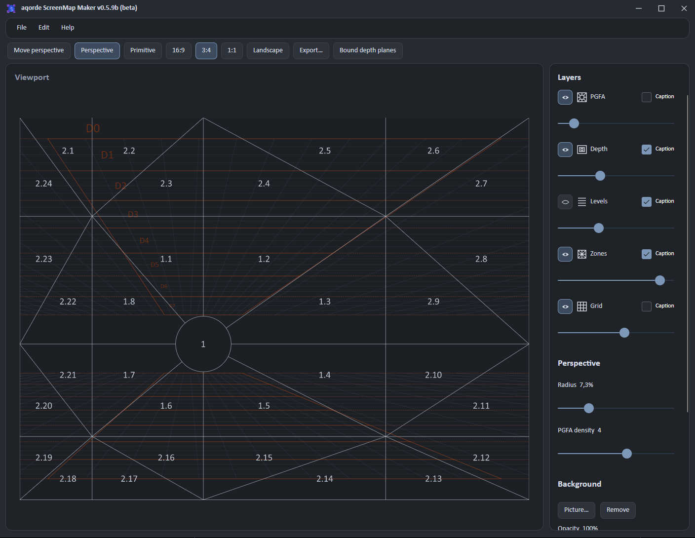

# aqorde ScreenMap Maker

A Windows tool for planning shots and creating composition references for image and video generation.

[Windows downloads](https://github.com/Aqorde/screenmap-maker/releases) · [По-русски](README-RU.md) · [MIT license](LICENSE.txt)



- Compose shots with screen zones, level bands and depth planes D0–D7.
- Move the perspective point beyond the image horizontally, or centre it again with **Perspective Reset**.
- Switch between a boxed grid and open sky and ground planes with evenly spaced projected columns.
- Adjust background transparency with or without a photo and export PNG or SVG.
- Export a matching prompt template in English or Russian.

The Windows x64 release includes an installer and a portable ZIP. For the portable edition, extract the entire archive and run `ScreenmapMaker.exe`.

## Build

Install the .NET SDK listed in [global.json](global.json), Visual Studio 2026 with Desktop development with C++, and PowerShell 7. Inno Setup 6 is needed for the installer.

```powershell
pwsh -File scripts/build.ps1 -Both -Publish -Verify -DesktopRender
pwsh -File scripts/build-installer.ps1
```

Build and verification output is written to `out/`. Release packages are written to `releases/`. [Verification guide](docs/TESTING-0.5.md)

ScreenMap Maker is a standalone project from [aqorde](https://github.com/Aqorde). Third-party notices are bundled with the Windows release.
